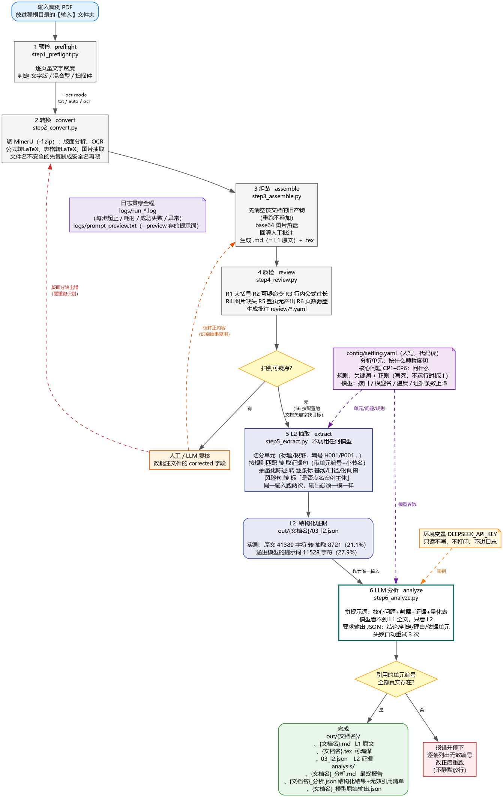

# PDF → LaTeX / Markdown + 规则抽取：一次可回溯的案例分析

把一份案例 PDF 转成 LLM 能读的 Markdown 与 LaTeX，再用配置里的规则在正文中抽证据，最后让模型只在证据上做判断，并逐个校验它引用的单元编号。

做这套流程的目的不是"让 AI 帮我写分析"，而是让案例分析**可回溯**：报告里的每个结论都能指回原文某一段，换个人读同一份材料能得到同样的证据与判断。



## 流程

```
预检 → 版面解析与 OCR（MinerU）→ 组装 Markdown / LaTeX → 质检
     → 规则抽证据（L2，带单元编号）→ 模型判读 → 引用校验与一致性检查
```

- **转换层**：MinerU 4.x 做版面分析、文字识别、公式与表格识别、图片抽取；LaTeX 由 Pandoc 生成，与 Markdown 同源。
- **抽取层**：正文按段落切成带编号的单元（H001… 标题、P001… 段落），按配置里的关键词与正则抽证据，每条证据带编号与命中理由。
- **判定层**：模型只读证据、不读全文，输出"结论 / 判定 / 理由 / 依据编号"的 JSON；程序先做存在性校验（引用的编号必须真实存在），再跑两次比对判定是否一致。

## 本次运行的真实结果

| 指标 | 数值 |
|---|---|
| 输入 | 20 页英文论文，文字版，9 张表、1 张插图 |
| 转换耗时 | 66.2 秒 |
| 全文产出 | Markdown 41,389 字符 / LaTeX 50,977 字符 |
| 质检 | 0 处待核 |
| 分析单元 | 158 个（34 个标题 + 124 个段落） |
| 证据总量 | 8,721 字符，占原文 21.1% |
| 送入模型 | 11,528 字符，占原文 27.9% |
| 引用校验 | 20 处引用，无效 0 处 |
| 判定稳定性 | 两次独立运行，六个判定完全一致 |

六个核心问题的证据分布（命中段落 / 命中次数）：数据来源 9/25、技术路径 72/139、业务落点 38/94、效果证据 26/64、代价与风险 18/44、可迁移性 9/23。

## 案例说明（关于原文）

本次案例是 BOUKHORS Ahmed Amine 发表于 *les cahiers du POIDEX* 2026 年第 15 卷第 1 期（第 337–356 页）的比较研究，对比美国银行与摩根士丹利的人工智能采用策略。

**本仓库不包含该论文原文，也不包含其全文转换结果。** 该文未见开放许可（Creative Commons）声明，整篇再分发不合适。想复现请自备一份同类 PDF：

```bash
cp 你的案例.pdf code/输入/
cd code && python run.py --input 输入
```

## 目录

```
code/
  run.py              入口
  launcher.py         交互式启动
  start.bat           Windows 双击启动
  steps/              六个步骤：预检 / 转换 / 组装 / 质检 / 抽取 / 判读
  config/setting.yaml 规则配置（关键词、正则、判据、提示词）
docs/
  report_public.pdf   课程实验报告（已去掉班级与学号）
  pipeline.png        流程图
```

## 环境

- Python 3.11（MinerU 4.x 对版本敏感，建议单独建环境）
- MinerU 4.0.6 + PaddleOCR（首次运行会下载模型）
- `pip install -r code/requirements.txt`
- 第 6 步判读需要 `DEEPSEEK_API_KEY` 环境变量；前五步不需要密钥，照样产出全文与证据

```bash
# 只跑前五步（无密钥）
python code/run.py --input 输入 --skip-analyze
# 只重跑第 6 步
python code/run.py --input 输入 --only analyze
```

## 设计上的几个取舍

- **证据层会漏，模型补不回来。** 规则漏掉的句子模型看不到，所以抽取按句返回、每段最多留三句，宁可少不可混。
- **编号校验只挡硬错误。** 它能抓住"模型编了一个不存在的编号"，抓不住"引到了真编号但引错"。后者仍要人看。
- **规则层不调模型。** 同一份配置跑两遍结果一致，判定层的随机性才被单独隔离出来，可测。
- **产物目录每次先清空。** 重跑覆盖旧结果，不叠加。

## 说明

实验报告是《大数据应用案例分析》课程作业，公开版已删除班级与学号。代码与流程可自由参考。
